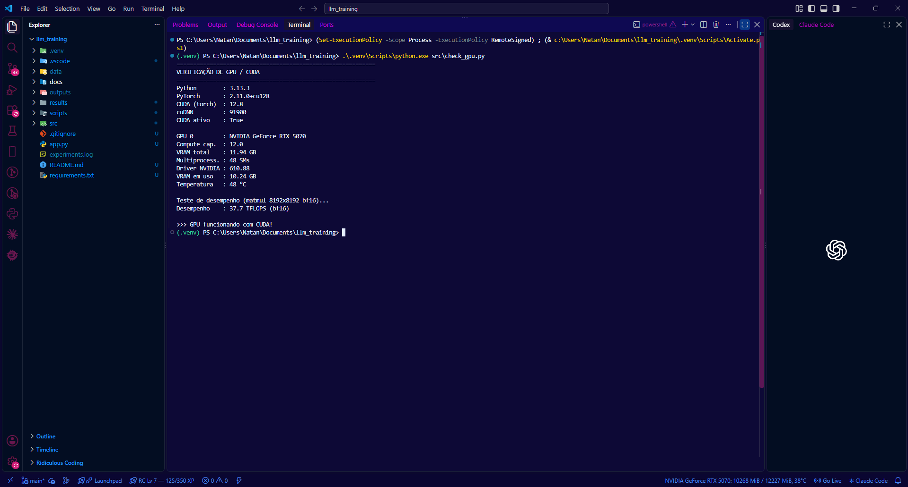
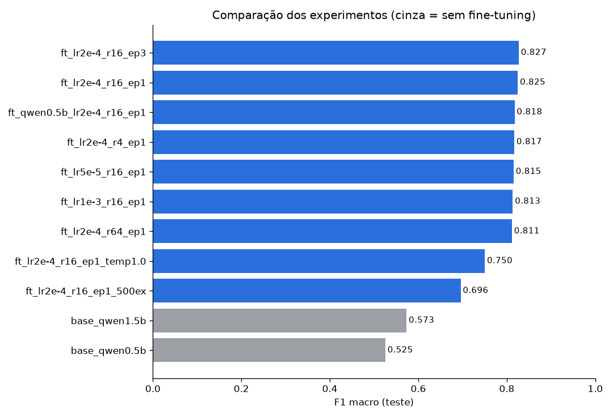
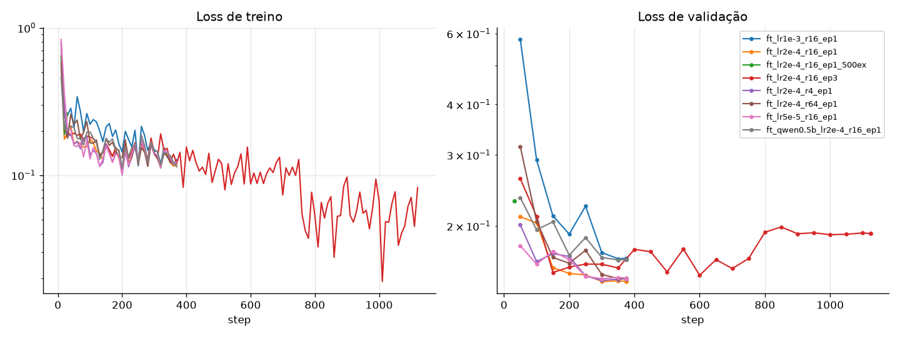
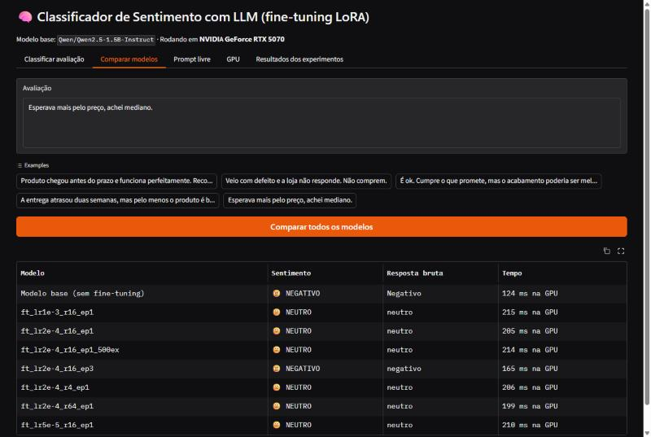

# 🧠 Fine-tuning de LLM local para Análise de Sentimento em PT-BR

Trabalho acadêmico: treinar uma LLM **localmente, na GPU**, para resolver um problema específico, testar
diferentes parâmetros, avaliar o modelo e disponibilizar um frontend para o usuário criar prompts.

## 👥 Grupo

| Nome | RM |
|---|---|
| Enzo Luiz Goulart | RM99666 |
| Kayky Paschoal Ribeiro | RM99929 |
| Lucas Yuji Farias Umada | RM99757 |
| Natan Eguchi dos Santos | RM98720 |
| João Pedro do Vale Cruz Novo | RM98650 |

---

## 1. Problema escolhido

**Classificar o sentimento de avaliações de produtos de e-commerce brasileiro** em três classes:
`positivo`, `negativo` ou `neutro`.

É um problema real (lojas recebem milhares de avaliações por dia), em português, e **objetivamente
mensurável**: dá para comparar a resposta do modelo com a nota que o próprio cliente deu.

### Dataset — B2W-Reviews01

- Fonte: [ruanchaves/b2w-reviews01](https://huggingface.co/datasets/ruanchaves/b2w-reviews01) (Hugging Face), licença CC-BY 4.0
- ~130 mil avaliações reais da Americanas.com (jan–mai/2018)
- Rótulo derivado da nota (`overall_rating`): **1–2 → negativo**, **3 → neutro**, **4–5 → positivo**
- Texto usado: `título. texto da avaliação` (descartadas avaliações com < 10 ou > 600 caracteres e duplicadas)
- Amostragem **balanceada** (mesma quantidade por classe), semente 42:

| Split | Por classe | Total |
|---|---|---|
| treino | 2.000 | 6.000 |
| validação | 100 | 300 |
| teste | 300 | 900 |

## 2. LLM escolhida

**[Qwen2.5-1.5B-Instruct](https://huggingface.co/Qwen/Qwen2.5-1.5B-Instruct)** (Alibaba, licença Apache 2.0).

Por quê:
- **Multilíngue** com bom suporte a português;
- Versão *Instruct* já segue o formato de chat — o fine-tuning só precisa especializar a tarefa;
- **1,5 bilhão de parâmetros** cabe com folga em 12 GB de VRAM em bf16, permitindo rodar vários
  experimentos em poucos minutos cada;
- Também testamos a irmã menor **Qwen2.5-0.5B-Instruct** para comparar o efeito do tamanho do modelo.

### Técnica: LoRA (Low-Rank Adaptation)

Em vez de atualizar os 1,5 bi de pesos, o LoRA congela o modelo original e treina pequenas matrizes de
baixo rank inseridas nas camadas de atenção e MLP (`q,k,v,o,gate,up,down_proj`). Treina-se < 2% dos
parâmetros, com muito menos memória, e o resultado é um "adaptador" de poucos MB.

A loss é calculada **apenas nos tokens da resposta** (o rótulo), não no prompt.

Formato do prompt (chat template do Qwen):

```
[system] Você é um classificador de sentimento de avaliações de produtos de e-commerce brasileiro.
         Responda apenas com uma palavra: positivo, negativo ou neutro.
[user]   Avaliação: <texto>
         Qual é o sentimento?
[assistant] positivo
```

## 3. Ambiente e GPU

Todos os treinos e testes foram executados **na GPU**:

| Item | Valor |
|---|---|
| GPU | NVIDIA GeForce RTX 5070 — 12 GB GDDR7, arquitetura Blackwell (compute capability 12.0) |
| Driver NVIDIA | 610.88 |
| PyTorch | 2.11.0 + **CUDA 12.8** (cuDNN 9.19) |
| Python | 3.13 |
| Bibliotecas | transformers 5.18 · peft 0.21 · datasets 5.0 · accelerate 1.15 · gradio 6.29 |
| SO / IDE | Windows 11 · VSCode 1.137 |
| Desempenho medido (`check_gpu.py`) | ~40 TFLOPS em bf16 (matmul 8192²) |

> ⚠️ **Placas RTX série 50 (Blackwell) só funcionam com PyTorch compilado para CUDA ≥ 12.8.** Com
> builds `cu118`/`cu121`/`cu124` o PyTorch dá erro `no kernel image is available for execution on the device`.

### Print da GPU funcionando no VSCode



Extensões do VSCode usadas para monitorar a GPU (já recomendadas em `.vscode/extensions.json`):
- **GPU Environments** — `run-ai.vscode-genv`
- **GPU Monitor** — `maimonator.gpu-monitor`

## 4. Como executar

```powershell
# 1) Ambiente virtual
python -m venv .venv
.\.venv\Scripts\Activate.ps1

# 2) PyTorch com CUDA 12.8 (obrigatório para RTX série 50 / Blackwell; serve para séries 20/30/40 também)
pip install torch --index-url https://download.pytorch.org/whl/cu128
pip install -r requirements.txt

# 3) Verificar a GPU (tire o print desta saída no terminal do VSCode)
python src/check_gpu.py

# 4) Preparar os dados
python src/prepare_data.py

# 5a) Rodar TODOS os experimentos + comparação
.\scripts\run_experiments.ps1

# 5b) ...ou um experimento isolado
python src/train.py --run-name meu_teste --lr 2e-4 --lora-r 16 --epochs 1
python src/evaluate.py --run-name meu_teste --adapter outputs/meu_teste
python src/compare_results.py

# 6) Frontend
python app.py      # http://127.0.0.1:7860
```

> **Versão do CUDA:** o PyTorch já traz o runtime CUDA embutido na wheel; basta ter o **driver NVIDIA**
> atualizado. Escolha o índice conforme a placa: RTX 50xx → `cu128` ou mais novo; RTX 20/30/40 → `cu126`
> ou `cu128`. Confira com `nvidia-smi` (a versão de CUDA mostrada é a máxima suportada pelo driver).

### Estrutura

```
├── app.py                    # Frontend Gradio
├── src/
│   ├── common.py             # prompt, parsing de rótulo, carregamento do modelo
│   ├── check_gpu.py          # informações da GPU + teste de desempenho
│   ├── prepare_data.py       # download e splits balanceados
│   ├── train.py              # fine-tuning LoRA
│   ├── evaluate.py           # métricas, matriz de confusão, predições
│   └── compare_results.py    # tabela + gráficos comparativos
├── scripts/run_experiments.ps1
├── results/                  # métricas e gráficos de cada experimento (versionado)
├── outputs/                  # adaptadores LoRA treinados (não versionado)
└── docs/prints/              # prints para a entrega
```

## 5. Experimentos — parâmetros testados

Configuração de referência: `lr=2e-4`, `LoRA r=16 (alpha=32, dropout=0.05)`, `1 época`,
batch 8 × acumulação 2 (batch efetivo 16), scheduler cosseno com 5% de warmup, bf16,
gradient checkpointing, máx. 320 tokens. A partir dela, variamos **um parâmetro de cada vez**:

| Parâmetro | Valores testados | Por quê |
|---|---|---|
| Modelo | Qwen2.5-**0.5B** vs **1.5B** | Efeito do tamanho do modelo |
| Fine-tuning | sem (zero-shot) vs com LoRA | O treino realmente ajuda? |
| Learning rate | 5e-5 · **2e-4** · 1e-3 | Velocidade/estabilidade do aprendizado |
| LoRA rank (r) | 4 · **16** · 64 | Capacidade do adaptador vs nº de parâmetros |
| Épocas | **1** · 3 | Mais treino ajuda ou causa overfitting? |
| Qtde. de dados | 500 · **6.000** exemplos | Sensibilidade à quantidade de dados |
| Temperatura (inferência) | **0** (greedy) · 1.0 | Efeito da aleatoriedade na geração |

## 6. Avaliação do modelo

Avaliação no **conjunto de teste (900 avaliações nunca vistas, 300 por classe)**. O modelo gera texto
livre e o rótulo é extraído da resposta; respostas fora de `positivo/negativo/neutro` contam como erro
("Inválidas"). Métricas: acurácia e **F1 macro** (média do F1 das 3 classes — a métrica principal,
pois não favorece nenhuma classe).

### Resultados

| Experimento | Modelo | LR | LoRA r | Épocas | Treino (s) | VRAM pico (GB) | Temp. | Acurácia | F1 macro | Inválidas |
|---|---|---|---|---|---|---|---|---|---|---|
| ft_lr2e-4_r16_ep3 | Qwen2.5-1.5B | 2e-4 | 16 | 3 | 901 | 7.20 | 0 | 0.827 | **0.827** | 0 |
| ft_lr2e-4_r16_ep1 ⭐ | Qwen2.5-1.5B | 2e-4 | 16 | 1 | 347 | 7.20 | 0 | 0.827 | 0.825 | 0 |
| ft_qwen0.5b_lr2e-4_r16_ep1 | Qwen2.5-0.5B | 2e-4 | 16 | 1 | 210 | 5.04 | 0 | 0.819 | 0.818 | 0 |
| ft_lr2e-4_r4_ep1 | Qwen2.5-1.5B | 2e-4 | 4 | 1 | 302 | 7.04 | 0 | 0.818 | 0.817 | 0 |
| ft_lr5e-5_r16_ep1 | Qwen2.5-1.5B | 5e-5 | 16 | 1 | 346 | 7.20 | 0 | 0.817 | 0.815 | 0 |
| ft_lr1e-3_r16_ep1 | Qwen2.5-1.5B | 1e-3 | 16 | 1 | 341 | 7.20 | 0 | 0.814 | 0.813 | 0 |
| ft_lr2e-4_r64_ep1 | Qwen2.5-1.5B | 2e-4 | 64 | 1 | 348 | 7.82 | 0 | 0.812 | 0.811 | 0 |
| ft_lr2e-4_r16_ep1 (temp 1.0) | Qwen2.5-1.5B | 2e-4 | 16 | 1 | — | — | 1.0 | 0.749 | 0.750 | 2 |
| ft_lr2e-4_r16_ep1_500ex | Qwen2.5-1.5B | 2e-4 | 16 | 1 | 32 | 6.23 | 0 | 0.689 | 0.696 | 0 |
| base_qwen1.5b (sem treino) | Qwen2.5-1.5B | — | — | — | — | — | 0 | 0.664 | 0.573 | 0 |
| base_qwen0.5b (sem treino) | Qwen2.5-0.5B | — | — | — | — | — | 0 | 0.631 | 0.525 | 32 |

Tabela gerada automaticamente em [`results/comparison.md`](results/comparison.md). Cada experimento
tem em `results/<nome>/` as métricas por classe, a matriz de confusão, o log de treino e todas as predições.




### Análise

1. **O fine-tuning funciona:** F1 macro de **0,573 → 0,825** (+25 pontos) no modelo de 1,5B, com
   apenas 6 minutos de treino na GPU e 1,2% dos parâmetros treinados.
2. **O modelo base "não sabe" o que é neutro:** sem treino, ele quase nunca responde `neutro`
   (recall de **8%**) — força tudo para positivo/negativo. Após o fine-tuning, o recall de neutro vai a **71%**.
3. **Formato da resposta:** o Qwen-0.5B sem treino deu **32 respostas inválidas** (ex.: "Negação",
   "Neste cenário, a avaliação parece..."). Todos os modelos treinados responderam **100% no formato**.
4. **Tamanho do modelo:** depois do fine-tuning, o **0.5B (0,818) fica quase empatado com o 1.5B
   (0,825)**, treinando 40% mais rápido e usando 30% menos VRAM. Para uma tarefa específica,
   um modelo pequeno especializado compete com um maior.
5. **Learning rate:** 2e-4 foi o melhor. 1e-3 aprende mais rápido mas é instável (veja os picos na loss
   de validação); 5e-5 é estável mas fica um pouco atrás em 1 época.
6. **LoRA rank:** r=4, 16 e 64 dão resultados muito próximos (0,811–0,825). Aumentar o rank
   (mais parâmetros) não ajudou — a tarefa precisa de pouca capacidade extra.
7. **Épocas / overfitting:** 3 épocas deram F1 praticamente igual (0,827 vs 0,825) com **2,6× o
   tempo**. A loss de validação fica em ~0,15–0,16 nas duas primeiras épocas e **sobe para ~0,19 na
   3ª época (a partir do step ~750)**, enquanto a de treino continua caindo — sinal clássico de
   **overfitting** (o modelo fica "confiante demais" nos exemplos de treino). **1 época é a melhor escolha** (⭐).
8. **Quantidade de dados:** com 500 exemplos o F1 cai para 0,696 — ainda melhor que o zero-shot,
   mas mostra que mais dados importam mais que ajustar hiperparâmetros.
9. **Temperatura:** amostrar com temperatura 1.0 derruba o F1 de 0,825 para 0,750 e volta a gerar
   respostas inválidas. Para **classificação, usar temperatura 0** (determinístico).

#### Onde o modelo erra

Desempenho por classe (modelo ⭐): **negativo F1 0,89 · positivo 0,85 · neutro 0,74**.
Dos 156 erros do modelo ⭐, **150 envolvem a classe neutro** e só **6** confundem positivo com negativo.
Muitos "erros" são ruído do próprio rótulo, já que a nota do cliente nem sempre bate com o texto:

| Texto da avaliação | Nota do cliente → rótulo | Modelo |
|---|---|---|
| "Satisfeito com o produto.. Muito bom a rapidez da entrega e o produto de boa qualidade." | 3 → neutro | positivo |
| "Demora na entrega. ... até hoje ainda não recebi o produto." | 3 → neutro | negativo |
| "Regular. Produto frágil, a potência até que é boa, mas..." | 2 → negativo | neutro |

### Conclusões

- LoRA permite especializar uma LLM em minutos numa GPU doméstica, com ganho grande e mensurável.
- A configuração recomendada é **Qwen2.5-1.5B + LoRA r=16, lr=2e-4, 1 época, temperatura 0**
  (ou o 0.5B, se for preciso economizar recursos).
- O limite de desempenho agora está mais nos **dados** (rótulos ruidosos da classe neutra) do que no modelo.

## 7. Frontend

`python app.py` abre uma interface web com 5 abas:

| Aba | O que faz |
|---|---|
| **Classificar avaliação** | Usuário digita uma avaliação, escolhe o modelo (base ou qualquer adaptador treinado) e a temperatura |
| **Comparar modelos** | Roda a mesma avaliação em todos os modelos lado a lado |
| **Prompt livre** | Usuário cria qualquer prompt + system prompt, ajustando temperatura, top-p e máx. de tokens (resposta em streaming) |
| **GPU** | Uso de VRAM, utilização, temperatura e consumo da GPU em tempo real |
| **Resultados** | Tabela e gráficos dos experimentos |

Todos os adaptadores ficam carregados ao mesmo tempo sobre **um único** modelo base na GPU
(`PeftModel.load_adapter` / `set_adapter`), e o modelo base "puro" é obtido desligando o LoRA
(`disable_adapter`) — por isso trocar de modelo é instantâneo.



> O dropdown lista o modelo base 1.5B e os adaptadores treinados sobre ele. O adaptador do Qwen-0.5B
> usa outro modelo base e, por isso, é avaliado só via `src/evaluate.py`.

## 8. Problemas encontrados e soluções

| Problema | Causa | Solução |
|---|---|---|
| `Fatal Error: HW capability found ... requested 0x200000` ao baixar o modelo | O backend de download `hf_xet` do Hugging Face usa instruções de CPU que o processador não tem | `HF_HUB_DISABLE_XET=1` (já definido em `src/common.py`) |
| Treino extremamente lento (GPU a 99%, mas só ~65 W) | VRAM estourou e o driver do Windows passou a usar a RAM do sistema (*sysmem fallback*). Os logits (vocabulário de 151 mil tokens × batch 16 × ~300 tokens em fp32) ocupavam vários GB | Batch 8 + acumulação de gradiente 2 (mesmo batch efetivo) + gradient checkpointing → pico de 7,2 GB |
| `TrainingArguments got an unexpected keyword argument 'warmup_ratio'` | API mudou no transformers 5 | `warmup_steps=0.05` (float = fração) e `train_sampling_strategy="group_by_length"` |
| Erro do `datasets`/Arrow com `tokenizers.Encoding` | No transformers 5, `apply_chat_template(tokenize=True)` retorna um objeto `Encoding` | Gerar o texto com `tokenize=False` e tokenizar separadamente |

## 9. Referências

- Hu et al. (2021). *LoRA: Low-Rank Adaptation of Large Language Models*. arXiv:2106.09685
- Qwen Team (2024). *Qwen2.5 Technical Report*. arXiv:2412.15115
- Real, Oshiro & Mafra (2019). *B2W-Reviews01: an open product reviews corpus*. STIL
- Hugging Face — [Transformers](https://huggingface.co/docs/transformers), [PEFT](https://huggingface.co/docs/peft), [Gradio](https://www.gradio.app/)
